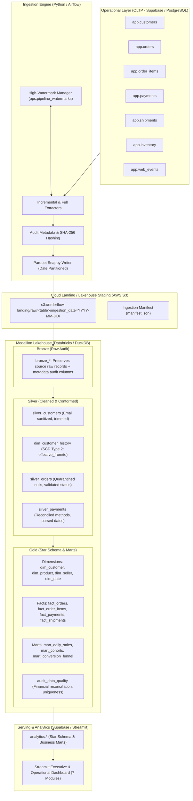

# 🏛️ OrderFlow Platform Architecture

## 1. System Overview

**OrderFlow** is an enterprise-grade lakehouse data platform designed for high-scale e-commerce operations. The architecture bridges operational transactional workloads (OLTP in PostgreSQL/Supabase) and high-performance analytical processing (OLAP Lakehouse via Databricks Delta Lake / DuckDB), serving executive dashboards, operational business marts, and data science workflows.

---

## 2. Medallion Architecture Principles

### 2.1 Bronze Layer (Raw & Immutable)
- **Role:** Direct 1:1 ingestion reflection of operational tables.
- **Format:** Parquet / Delta Lake with Snappy compression.
- **Partitioning:** `ingestion_date=YYYY-MM-DD/run_id=<run_id>/`.
- **Enrichment:** Standard operational metadata columns appended to every record:
  - `_ingested_at`: UTC timestamp of ingestion.
  - `_run_id`: Unique orchestration execution UUID.
  - `_source_system`: Identifying source database instance (`supabase_oltp`).
  - `_source_table`: Source table name.
  - `_schema_version`: Schema contract version.
  - `_record_hash`: Deterministic SHA-256 hash of all non-metadata attributes for deduplication.

### 2.2 Silver Layer (Cleaned, Standardized & SCD Type 2)
- **Role:** Conformed enterprise representation with deduplication and quality enforcement.
- **Transformations:**
  - Standardized string cleaning: lowercase, whitespace stripping, phone/email validation.
  - Quarantine of malformed or corrupt records without crashing pipelines.
  - Deduplication via `ROW_NUMBER() OVER (PARTITION BY <pk> ORDER BY updated_at DESC)`.
  - **SCD Type 2 Modeling:** Implemented for `customers` to preserve historical integrity across customer demographic and address changes over time (`effective_from`, `effective_to`, `is_current`).

### 2.3 Gold Layer (Dimensional Models & Business Marts)
- **Role:** High-performance Star Schema optimized for OLAP analytics, BI tools, and data science.
- **Dimensions:**
  - `dim_customer` (Current surrogate key dimension)
  - `dim_customer_history` (Full SCD Type 2 dimension)
  - `dim_product`, `dim_seller`, `dim_warehouse`, `dim_date`, `dim_payment_method`, `dim_channel`
- **Fact Tables:**
  - `fact_orders` (Order-grain metrics, tax, freight, items count, customer SK)
  - `fact_order_items` (Line-item grain with margin and pricing)
  - `fact_payments` (Transaction capture and status)
  - `fact_shipments` (Fulfillment delivery SLAs and transit days)
  - `fact_inventory_daily` (Daily warehouse inventory balance snapshot)
  - `fact_web_sessions` (Aggregated visitor sessions and pageview funnels)
- **Aggregated Business Data Marts:**
  - `mart_daily_sales` (Daily revenue, order volume, discounts, average order value)
  - `mart_customer_cohorts` (Monthly acquisition cohorts, repeat purchase rate, retention)
  - `mart_conversion_funnel` (Visitor drop-off from session -> view -> cart -> checkout -> order)
  - `mart_product_performance` (Category and product unit velocity, gross margin, return rate)
  - `mart_delivery_performance` (Carrier SLAs, on-time percentage, shipping delays)
  - `mart_inventory_health` (Stockout risk, reorder point alerts, days of inventory remaining)

---

## 3. Data Flow & Security Controls

1. **At-Rest Encryption:**
   - AWS S3 Server-Side Encryption (`AES256`) enforced for all uploaded landing files.
   - Postgres database connections enforce SSL (`sslmode=require`).
2. **Deterministic Checksumming:**
   - SHA-256 manifests generated at raw ingestion and Gold export.
   - Files are validated against tamper manifests before database publishing.
3. **Idempotent Ingestion & Publishing:**
   - Pipeline re-runs overwrite target partitions or perform atomic upserts without row duplication or metric drift.
